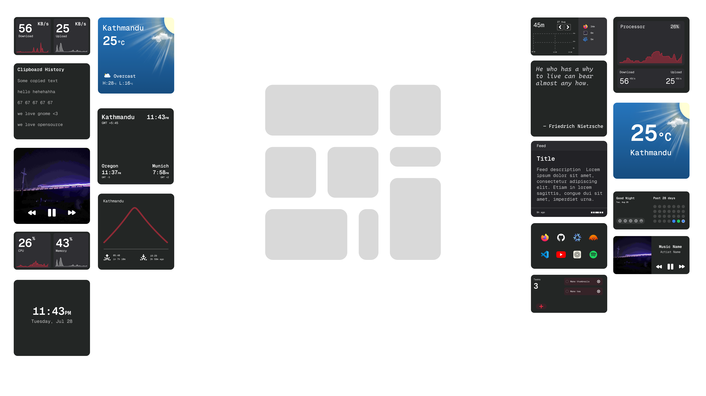
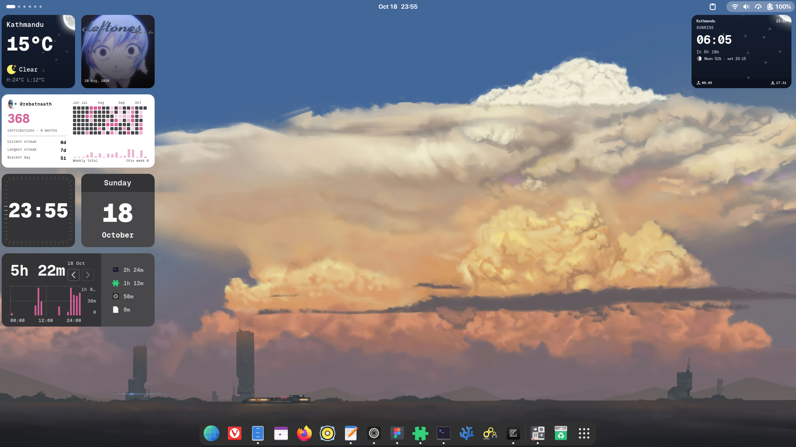
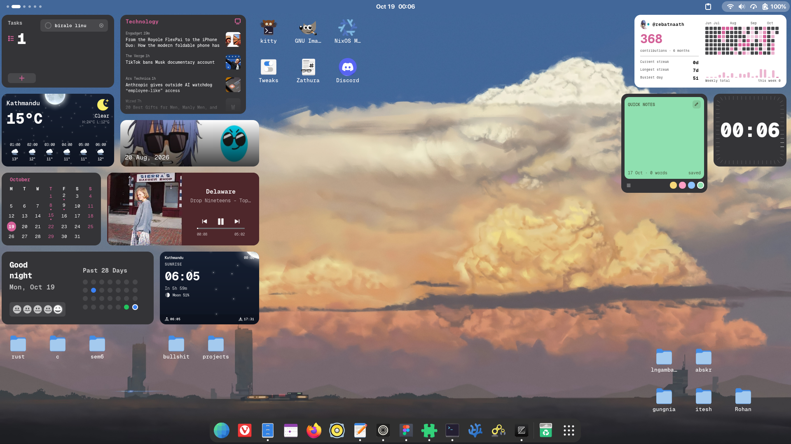

# Gridgets - GNOME Shell Widgets

<!--  -->


|  |  | 
| :---: | :---: |

Gridgets is a GNOME Shell extension that puts widgets on your desktop on a responsive
grid. Add a clock, weather, notes, music, a system monitor or an image, then move, resize
and style each one on its own. It runs on GNOME Shell 45 to 50.

<!-- ## User Guide

For a detailed walkthrough of all widgets, customization options, and desktop interactions, see the [User Guide](github/user-guide/README.md). -->

## Features

Widgets sit on a 60-column grid, snap to the cell you drop them on, and resize from the
corner handle. Each one keeps its own colours, fonts, corner radius and size, and
follows the system light and dark theme. Show the grid on one monitor or on all of them.

29 widgets ship with it: weather, time, calendar, music, system monitor, notes,
clipboard, pomodoro, tasks, GitHub, RSS, mood and images.

The right-click menu carries **Small**, **Medium** and **Large** presets. **Show Desktop
Icons** draws your desktop folder on the grid alongside the widgets, so a file added there
shows up on the desktop.

> [!IMPORTANT]
> **DING and desktop icons**
>
> DING draws its icons into its own layer, above the wallpaper and above the grid, and
> that layer takes the desktop right-click menu. With DING enabled you cannot click a
> widget to move or resize it, or open its own menu. The Gridgets settings still work, so
> the grid runs underneath, just not to clicks.
>
> Gridgets draws its desktop icons itself instead. Turn on **Show Desktop Icons** in the
> **Desktop** group on the Global Settings page, and every file and folder in `~/Desktop`
> appears on the grid, following the folder as you add and remove things. If that folder
> does not exist yet, the extension asks to create it. Each icon is a 3x3 widget like any
> other, so you can drag it, and the grid saves and rebuilds it. **Show Application
> Launchers** adds entries from your application menu. Each icon takes a right-click menu
> of its own: **Open**, **Open With…**, **Show in Files**, **Rename…**, **Move to
> Trash**, and the rest.

## Widget Requirements

Most widgets need nothing beyond GNOME Shell. A few read data from another application:

| Widget | Needs | If missing |
| --- | --- | --- |
| Weather, Solar Schedule | GNOME Weather | cannot be added |
| World Clock | GNOME Clocks | can be added; picker reports if unreachable |
| Calendar grid (event dots) | Evolution Data Server | adds fine, no events shown |

A widget that cannot be added is greyed out in the store with a tooltip saying what to
install.

## Known Limitations

**Music and browsers.** A browser registers itself as an MPRIS player and publishes
`MetadataChanged` for whatever it considers active. Most browsers do not implement `Next`
and `Previous`, so the skip buttons do nothing while the browser is the active player.
Hovering a video preview makes the browser publish that preview's metadata, which can
replace the playing track in the widget until real playback metadata arrives again.

**Flatpak-only GNOME Weather.** Gridgets looks for the executable on `PATH`, so a
Flatpak install is not found.

## Installation

Option A installs a tagged release, which is the stable build. Options B and C install
the current code from this repository, so they may have bugs a release does not.

<details>
<summary><b>Option A: From GitHub Releases</b> [stable release]</summary>

1. Download the latest `.zip` from the
   [Releases](https://github.com/rebatnaath/gridgets/releases) page.
2. Install it:
   ```bash
   gnome-extensions install --force gridgets@rebatnaath.github.com.shell-extension.zip
   ```
3. Restart GNOME Shell: log out and log back in.
4. Enable the extension:
   ```bash
   gnome-extensions enable gridgets@rebatnaath.github.com
   ```

</details>

<details>
<summary><b>Option B: Copy the files by hand</b> [latest code, may have bugs]</summary>

1. Disable the extension and remove any previous installation:
   ```bash
   gnome-extensions disable gridgets@rebatnaath.github.com
   rm -rf ~/.local/share/gnome-shell/extensions/gridgets@rebatnaath.github.com
   ```
   Disabling first stops GNOME Shell logging errors while the files are gone. Your
   settings and widget data are unaffected, since they live in dconf and under
   `~/.local/share/gridgets` rather than in the extension directory.
2. Copy the extension files:
   ```bash
   mkdir -p ~/.local/share/gnome-shell/extensions/gridgets@rebatnaath.github.com
   cp -r . ~/.local/share/gnome-shell/extensions/gridgets@rebatnaath.github.com
   ```
3. Compile the settings schema. `gschemas.compiled` is a build artifact and is not
   committed, so a fresh clone has only the `.gschema.xml`. Without this step the
   extension loads but every setting silently falls back to its default:
   ```bash
   glib-compile-schemas ~/.local/share/gnome-shell/extensions/gridgets@rebatnaath.github.com/schemas
   ```
4. Restart GNOME Shell: log out and log back in on Wayland, or press `Alt+F2` and then `r`
   on X11.
5. Enable:
   ```bash
   gnome-extensions enable gridgets@rebatnaath.github.com
   ```

</details>

<details>
<summary><b>Option C: Build a zip</b> [latest code, may have bugs]</summary>

1. From the project directory:
   ```bash
   gnome-extensions pack \
     --extra-source=assets \
     --extra-source=desktopGrid \
     --extra-source=shell \
     --extra-source=schemas \
     --extra-source=utils \
     --extra-source=widgets \
     --extra-source=prefs \
     --force
   ```
2. Install:
   ```bash
   gnome-extensions install --force gridgets@rebatnaath.github.com.shell-extension.zip
   ```
3. Restart and enable:
   ```bash
   gnome-extensions enable gridgets@rebatnaath.github.com
   ```

</details>

## NixOS

Gridgets reads data from three applications. Install the packages, and export
`gnome-weather`'s GSettings schema:

```nix
{
    home.packages = with pkgs; [
        gnome-weather
        gnome-clocks
        gnome-calendar
    ];

    services.gnome.evolution-data-server.enable = true;

    environment.sessionVariables.GSETTINGS_SCHEMA_DIR = [
        "${pkgs.gnome-weather}/share/gsettings-schemas/gnome-weather-${pkgs.gnome-weather.version}/glib-2.0/schemas"
    ];
}
```

The variable is needed because neither Home Manager's `home.packages` nor NixOS puts
package schemas on `XDG_DATA_DIRS`. Configuring NixOS itself, drop it and use
`services.xserver.desktopManager.gnome.extraGSettingsOverridePackages` instead.

`gnome-weather` also supplies the `GWeather` typelib that Gridgets imports. World clock
cities are not read from a schema: Gridgets asks GNOME Shell for them over D-Bus, and
GNOME Shell resolves the `gnome-clocks` schema itself, so only the weather schema has to
be exported.

Rebuild, log out and back in, then check:

```bash
command -v gnome-weather
command -v gnome-clocks
gsettings list-schemas | grep org.gnome.Weather
```

That should list `org.gnome.Weather`.

## Configuration

Open the **Extensions** app, or Extension Manager, and click the gear icon next to
Gridgets to change grid settings and style individual widgets.

## Widget Thumbnails

I am looking for a contributor to design the widget thumbnails. I would be very thankful
for the help, and a few widgets still fall back to a plain placeholder. If you are willing
to take it on, please open a pull request with the new thumbnails.

- **Canvas: 1000 x 1000.** Every existing thumbnail uses this size, so keep it consistent.
- **Format: SVG.** Any embedded screenshot should stay at or under 1000 px on its longest
  edge.
- Draw the widget as it really looks, and keep it readable in both light and dark themes.
- Add it under `assets/thumbnails/<category>/<name>.svg` and open a pull request. I will
  wire it into the store and the showcase.

## Links

- [Changelog](CHANGELOG.md) - what changed in each release.
- [Contributing guide](CONTRIBUTING.md) - read it before opening an issue or pull request.
- [GPL-3.0 licence](LICENSE).

Thanks to everyone who has contributed to Gridgets through code, bug reports and
suggestions.
